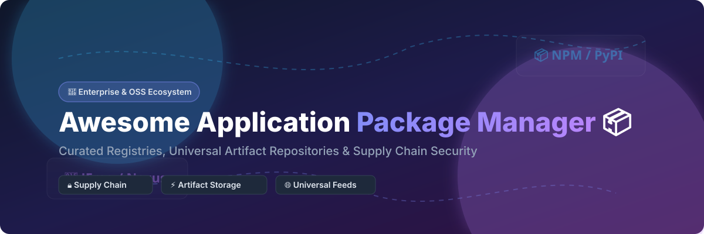

# Awesome-Application-Package-Manager 📦 🚀 ⚡

  

  
  
  
  
  
  

---

## 🌟 Top Application Package Manager Ecosystem & Universal Artifact Storage

**Curated List of Commercial Package Registries, Cloud Artifact Managers & Open-Source Package Management Systems**  
*Focused on Dependency Resolution, Universal Artifact Storage, Supply Chain Security, Package Registries, Software Distribution & Self-Hosted Repository Managers* 🛡️ ✨

**Last updated: October 2026** 📅

---

### 📌 Overview & SEO Summary 🔍

Welcome to the ultimate curated directory of **application package managers**, **universal artifact repositories**, **package registries**, and **software distribution platforms**. Whether you are evaluating enterprise-grade commercial SaaS platforms (such as *Salesforce AppExchange*, *Microsoft npm*, *JFrog Artifactory*, *Cloudsmith*, and *Sonatype Nexus*), or searching for self-hostable open-source alternatives (like *uv*, *pnpm*, *vcpkg*, *Scoop*, *Verdaccio*, *Chocolatey*, and *Conan*), this comprehensive guide covers category leaders, automated dependency resolution, lockfile reproducibility, and privacy-respecting artifact management. 🚀

#### 💡 Key Market Context & Trends:
- ⚡ **Salesforce Packaging Shift:** Salesforce is fully shifting development from first-generation packaging (1GP) to **second-generation managed packaging (2GP)** — 2GP is the **only packaging technology Salesforce is investing in**, featuring a CLI-driven development workflow.
- 📦 **PyPI Scale & Security:** PyPI served **2.56 trillion requests** and transferred **1.92 exabytes of data in 2025** (avg. 81,000 requests/sec), processing **over 2,000 malware reports** with **66% resolved within 4 hours**.
- 🍺 **Homebrew Ecosystem Upgrades:** **Homebrew 5.0.0** enables **parallel downloads by default**, elevates **Linux ARM64 to Tier 1 support**, and **deprecates un-signed casks**.
- 🍎 **CocoaPods Transition:** CocoaPods entered **maintenance mode**, designating **Swift Package Manager (SPM)** as Apple's official successor for iOS and macOS dependency management.
- ☕ **Maven Central Integrity:** Professionally managed by **Sonatype**, Maven Central enforces **mandatory GPG signing, namespace control, and metadata validation** to prevent supply chain threats.
- 🐸 **Universal Binary Management:** **JFrog Artifactory** and **Cloudsmith** support **28+ to 60+ package formats** (Docker, Helm, PyPI, npm, Maven, Cargo, NuGet, PyTorch, TensorFlow) across enterprise CI/CD workflows.

---

## 📑 Table of Contents 📖

- [🏢 SaaS & Commercial Platforms](#-saas--commercial-platforms)
- [🔓 Open-Source GitHub Projects](#-open-source-github-projects)
- [🛠️ How to Contribute](#%EF%B8%8F-how-to-contribute)
- [📊 Star History](#-star-history)
- [🤝 Support & Sponsorship](#-support--sponsorship)
- [⚠️ Disclaimer](#%EF%B8%8F-disclaimer)

---

## 🏢 SaaS & Commercial Platforms 💼

> **Market Analysis & Fragmentation Note:** 📊  
> The global application package management and artifact repository market is estimated at **$5.2 Billion in 2026** and is growing at a **18.4% CAGR**, driven by devsecops adoption, supply chain security compliance, and cloud-native container storage. The market is **moderately fragmented**: mega-cap hyper-scalers (Microsoft/GitHub) dominate public ecosystem registries (npm, PyPI, Maven Central), while dedicated enterprise platforms (JFrog, Salesforce, Cloudsmith, Sonatype) compete fiercely for enterprise private repository hosting and binary security governance.

| SaaS / Commercial Platform | Company / Owner | Market Cap / Valuation (Sort Metric) | Standard Edition Starting Price 💰 | Free Tier / Free Trial Limits 🎁 | Description 📝 |
| :--- | :--- | :--- | :--- | :--- | :--- |
| **[npm](https://www.npmjs.com/)** 📗 | Microsoft (via GitHub) | **~$3.90 Trillion** | **$7 / user / month** (Pro Tier for private packages) | **Free forever limit:** Unlimited public packages & 2,000 MB storage | **The world's largest JavaScript package registry** — Default registry for Node.js modules (`registry.npmjs.org`). Features granular team permissions, vulnerability audit (`npm audit`), and Automated Provenance attestations. 🌐 |
| **[Salesforce AppExchange](https://appexchange.salesforce.com/)** ☁️ | Salesforce, Inc. | **~$250.00 Billion** | **$25 / user / month** (Sales Cloud Starter) | **Free trial:** 30-day free trial with full Salesforce Developer Sandbox access | **Salesforce-native package distribution system** — Delivers Second-Generation Managed Packages (2GP) for ISV AppExchange distribution and unlocked packages for internal enterprise metadata management. ⚡ |
| **[JFrog Artifactory](https://jfrog.com/artifactory/)** 🐸 | JFrog Ltd. | **~$12.20 Billion** | **$98 / month** (Cloud Pro Plan) | **Free trial:** 14-day free trial (no credit card required, includes full enterprise features) | **Universal artifact repository manager** — Supports 60+ package formats (Maven, npm, PyPI, Docker, Helm, Cargo, PyTorch). Acts as a single source of truth for binaries with proxy caching & security scanning. 🛡️ |
| **[Cloudsmith](https://cloudsmith.com/)** 📦 | Cloudsmith Ltd. | **~$1.00 Billion** | **$49 / month** (Pro Tier) | **Free limit:** Free Core plan for Open-Source (50 GB storage & 200 GB/mo bandwidth) / 14-day trial | **Cloud-native universal package management platform** — Supports 28+ formats with native CLI integration, upstream proxying, "block-until-scan" policy enforcement, and multi-region continuous package delivery. ☁️ |
| **[Maven Central](https://central.sonatype.com/)** ☕ | Sonatype, Inc. | **Private (~$1.50 Billion)** | **$120 / user / year** (Sonatype Nexus Lifecycle) | **Free limit:** Unlimited free public Java artifact hosting for verified domains | **The foundational repository for Java/JVM ecosystem** — Enforces mandatory GPG artifact signing, strict namespace ownership validation, and automated policy verification. 🏛️ |
| **[Sonatype Nexus Repository](https://www.sonatype.com/products/nexus-repository)** 🔵 | Sonatype, Inc. | **Private (~$1.50 Billion)** | **$120 / user / year** (Nexus Repository Pro) | **Free limit:** Free Nexus OSS edition for self-hosted universal artifact hosting | **Enterprise universal repository manager** — High-availability proxy caching for Maven, npm, Docker, PyPI, NuGet, and Helm with role-based access control and cleanup policies. 🔐 |
| **[PyPI](https://pypi.org/)** 🐍 | Python Software Foundation | **Non-profit (N/A)** | **Free for public packages** (Supported by sponsors) | **Free limit:** Unlimited public Python packages (Max 10 GB per project limit) | **The official Python Package Index** — Handles over 80,000 requests/sec with Trusted Publishing (OIDC), digital signatures, and automated malware report scanning. 🐍 |
| **[Homebrew](https://brew.sh/)** 🍺 | Homebrew Association | **Open-Source (N/A)** | **Free** | **Free limit:** Unlimited free community usage | **The essential package manager for macOS and Linux** — Features parallel download capabilities, official ARM64 Tier 1 support, and automated formula bottle distribution. 🍺 |
| **[RubyGems](https://rubygems.org/)** 💎 | Ruby Central | **Non-profit (N/A)** | **Free for public gems** | **Free limit:** Unlimited public Ruby gems | **The standard Ruby package hosting service** — Integrated directly into Ruby runtime, providing gem creation, dependency resolution, and multi-factor authentication security. 💎 |
| **[CocoaPods](https://cocoapods.org/)** 🍫 | CocoaPods | **Open-Source (N/A)** | **Free** | **Free limit:** Unlimited free community usage | **Dependency manager for Swift and Objective-C** — Over 103K libraries hosted. (Maintained in legacy support mode alongside Apple Swift Package Manager). 📱 |

---

## 🔓 Open-Source GitHub Projects 🛠️

*Sorted by GitHub Star Count (Descending)* 🌟

- **[astral-sh/uv](https://github.com/astral-sh/uv)**   
  **An extremely fast Python package and project manager, written in Rust**, Apache-2.0 / MIT licensed. **10-100x faster than pip**, replacing pip, pip-tools, virtualenv, poetry, and pyenv with a unified workspace lockfile tool. 🐍 ⚡

- **[pnpm/pnpm](https://github.com/pnpm/pnpm)**   
  **Fast, disk space efficient package manager for JavaScript/Node.js**, MIT licensed. Uses a content-addressable hard-link store to save gigabytes of disk space across monorepos and projects. 📗 🚀

- **[microsoft/vcpkg](https://github.com/microsoft/vcpkg)**   
  **C++ Library Manager for Windows, Linux, and macOS**, MIT licensed. Simplifies acquiring and building C/C++ third-party libraries across diverse platform toolchains. ⚙️ 💻

- **[ScoopInstaller/Scoop](https://github.com/ScoopInstaller/Scoop)**   
  **A command-line installer for Windows**, Unlicense licensed. Installs developer tools silently into user home directories without requiring administrator privileges or GUI popups. 🥄 🪟

- **[verdaccio/verdaccio](https://github.com/verdaccio/verdaccio)**   
  **A lightweight Node.js private proxy registry**, MIT licensed. The leading self-hosted private npm registry with caching for public npmjs.org packages and plugin authentication. 📗 📦

- **[chocolatey/choco](https://github.com/chocolatey/choco)**   
  **The package manager for Windows**, Apache-2.0 licensed. Software management automation platform utilizing PowerShell for standard Windows application deployment. 🍫 🪟

- **[jordansissel/fpm](https://github.com/jordansissel/fpm)**   
  **Effing package management! Build packages for multiple platforms with great ease**, MIT licensed. Convert seamlessly between deb, rpm, tar, gem, and zip package formats. 🔧 📦

- **[conan-io/conan](https://github.com/conan-io/conan)**   
  **The open-source, decentralized C/C++ package manager**, MIT licensed. Supports binary package management for cross-platform C/C++ development across CMake, Meson, and MSBuild. 🛠️ ⚙️

- **[prefix-dev/pixi](https://github.com/prefix-dev/pixi)**   
  **A fast, modern and reproducible package management tool**, BSD-3-Clause licensed. Built in Rust, supporting both PyPI and Conda package ecosystems for cross-language dependency management. 🐍 🔬

- **[Homebrew/homebrew-bundle](https://github.com/Homebrew/homebrew-bundle)**   
  **Bundler for Homebrew, Homebrew Cask, and Mac App Store**, BSD-2-Clause licensed. Declarative dependency management via `Brewfile` supporting casks, formulas, and VSCode extensions. 🍺 📜

- **[cargo-bins/cargo-binstall](https://github.com/cargo-bins/cargo-binstall)**   
  **Binary installation for cargo packages**, MIT / Apache-2.0 licensed. Installs pre-compiled Rust binaries directly from GitHub releases without needing local compilation. 🦀 ⚡

- **[sonatype/nexus-public](https://github.com/sonatype/nexus-public)**   
  **Nexus Repository Manager Core**, Eclipse Public License. The open-source core of Sonatype Nexus, proxying Maven, npm, PyPI, Docker, and NuGet artifacts. 🔵 🏛️

- **[dzikoysk/reposilite](https://github.com/dzikoysk/reposilite)**   
  **Lightweight Maven repository manager**, Apache-2.0 licensed. Uses under 20MB RAM to host Java/Kotlin Maven artifacts as a lightweight replacement for Nexus or Artifactory. ☕ ⚡

- **[artipie/artipie](https://github.com/artipie/artipie)**   
  **Binary Artifact Management Tool**, MIT licensed. Modern reactive binary storage repository supporting Maven, npm, PyPI, Docker, and RPM via YAML configurations. 🛠️ 📂

- **[pulp/pulp](https://github.com/pulp/pulp)**   
  **Platform for managing repositories of software content**, GPL-2.0 licensed. Flexible content management platform for RPM, Debian, PyPI, and Ansible collections. 🐧 📦

- **[apache/archiva](https://github.com/apache/archiva)**   
  **The Apache Build Artifact Repository Manager**, Apache-2.0 licensed. The classic Apache Foundation repository manager for Maven artifact administration and proxying. 🏛️ ☕

- **[candrewlee14/webman](https://github.com/candrewlee14/webman)**   
  **A cross-platform package manager for the web**, MIT licensed. Manages web binaries locally without root privileges using simple YAML recipe files. 🌐 📁

---

## 🛠️ How to Contribute 🤝

Contributions are very welcome! Follow these simple steps to add new package managers, artifact repositories, or registry tools: 🚀

1. 🍴 **Fork** this repository.
2. 📝 **Add/Edit** entries in `README.md` following the exact tabular / list format and star count badge structure.
3. 🔗 Include project title, official website/GitHub link, exact star count, license, and concise feature summary.
4. 🚀 Open a **Pull Request** with a descriptive title.

---

## 🤝 Support & Sponsorship ☕

Thank you so much for visiting and using this repository! If this curated list has been helpful to your workflow or project development, please consider showing your support:

- ⭐ **Star** this repository to help increase its visibility!
- 🔀 **Fork** and share it with fellow developers and DevOps engineers.
- ☕ **Buy Me a Coffee / Sponsor**: Support ongoing open-source curation and maintenance via the [GitHub Sponsor Dashboard](https://github.com/sponsors/ishandutta2007).

---

## 📊 Star History

---

## ⚠️ Disclaimer ℹ️

- This is a **community-curated list** — not an exhaustive list or commercial endorsement. ℹ️
- **Packaging Ecosystem Shifts:** Salesforce is deprecating 1GP in favor of 2GP [citation:1]. CocoaPods is in maintenance mode while Apple champions Swift Package Manager [citation:6]. Homebrew enforcement updates deprecate un-signed casks [citation:5].
- **Security & Integrity:** Always verify package signatures, provenance attestations, and hashes before deploying dependencies into enterprise production pipelines. 🛡️

---

  <b>Made with ❤️ for developers, DevOps engineers, and package management advocates worldwide.</b>

